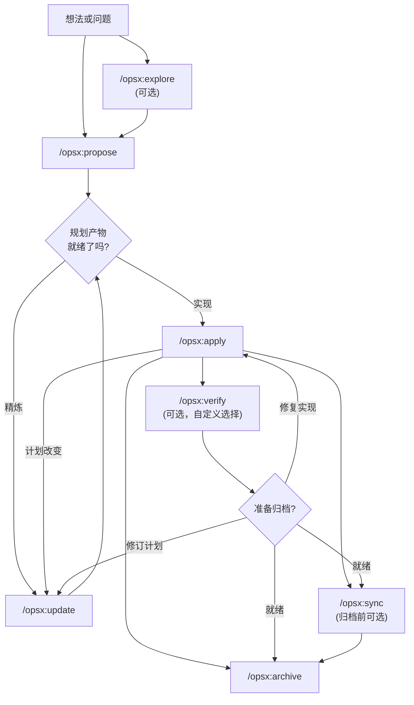
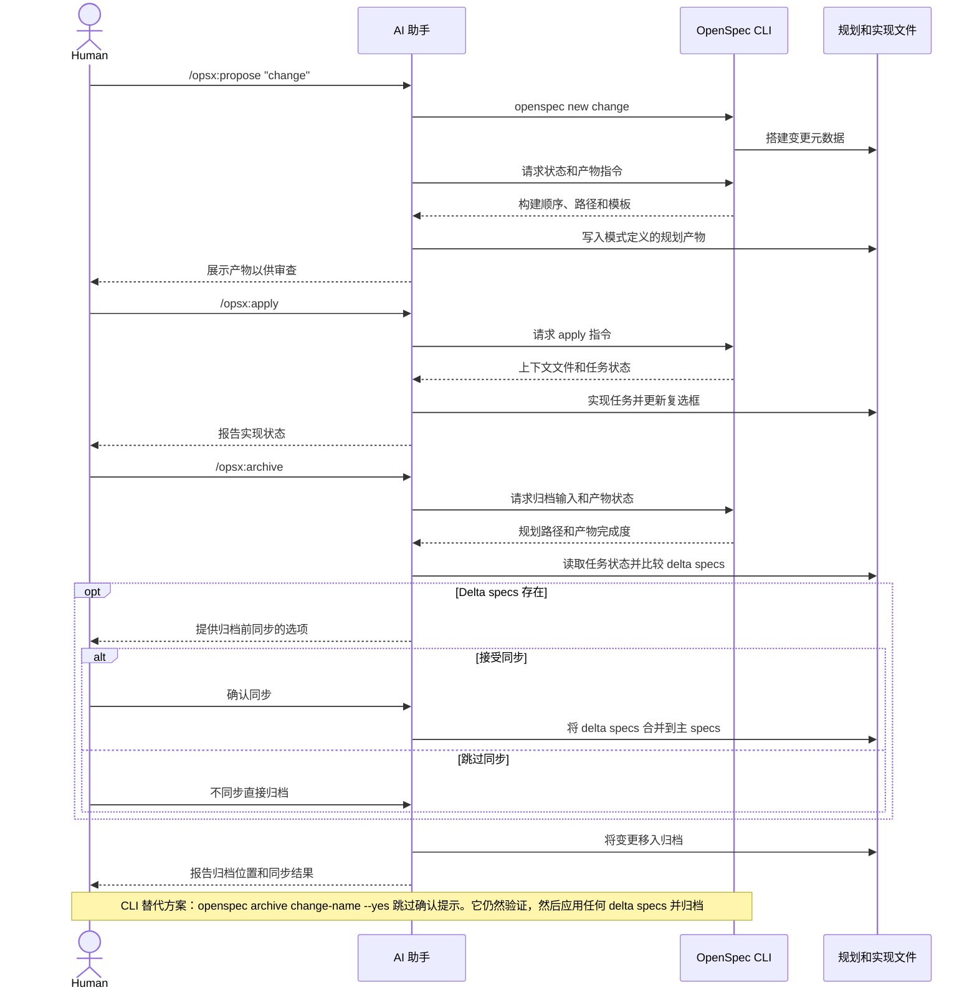

# 工作流

本指南涵盖了 OpenSpec 的常见工作流模式以及何时使用每种模式。基本设置请参见 [入门指南](getting-started.md)。命令参考请参见 [命令](commands.md)。

## 哲学：行动，而非阶段

传统工作流强迫你经历阶段：先规划，再实现，然后完成。但真实工作并不会 neatly fit into boxes。

OPSX 采取了一种不同的方法：

```text
传统（阶段锁定）:

  PLANNING ────────► IMPLEMENTING ────────► DONE
      │                    │
      │   "不能回去"       │
      └────────────────────┘

OPSX（流畅行动）:

  proposal ──► specs ──► design ──► tasks ──► implement
```

**关键原则：**

- **行动，而非阶段** — 命令是你可以做的事，不是你被困住的阶段
- **依赖关系是使能器** — 它们展示什么可做，而不是下一步必须做什么

> **自定义：** OPSX 工作流由定义产物序列的模式驱动。有关创建自定义模式的详细信息，请参见 [自定义配置](customization.md)。

## 工作流概览

默认工作流保持流畅：探索和验证是可选的，
你可以在实现过程中发现新内容时随时更新规划产物。



AI 助手驱动工作流，而 CLI 提供确定性的
脚手架、状态查询和产物指令：



## 两种模式

### 默认快速路径 (`core` 配置)

新安装默认使用 `core`，它提供：
- `/opsx:explore`
- `/opsx:propose`
- `/opsx:apply`
- `/opsx:update`
- `/opsx:sync`
- `/opsx:archive`

典型流程：

```text
/opsx:explore ──► /opsx:propose ──► /opsx:apply ──► /opsx:sync ──► /opsx:archive
  (可选)
```

#### 从探索开始（值得养成的习惯）

`/opsx:explore` 是默认配置的一部分，不是高级附加功能。它是当你有问题但还没有计划时的首选动作，而有了 AI 助手，大多数时候都是如此。

```text
You: /opsx:explore

AI:  你想探索什么？

You: 我们的搜索结果感觉陈旧。我不确定是缓存、
     索引还是查询本身的问题。

AI:  让我看看...[读取搜索服务和缓存层]
     是索引问题：它只每晚重建一次，所以编辑内容要到
     第二天才显示。两个选项：写入时重建（简单，
     负载更大）或短 TTL 缓存失效（更多移动部件，
     负载更小）。鉴于你的写入量很低，写入时重建是
     更干净的修复。要确定范围吗？

You: 是的。

You: /opsx:propose rebuild-search-index-on-write
```

Explore 从不写代码，也从不写其他内容，除非你要求它记录你决定的内容，或在它提供时同意。这是一个免费、无风险的对话，将模糊的担忧转化为精确的变更，所以接下来的 proposal 会很清晰。已经确切知道你想要什么？跳过它，直接去 `/opsx:propose`。完整指南：[探索优先](explore.md)。

### 扩展/完整工作流（自定义选择）

如果你想要显式的脚手架和构建命令（`/opsx:new`、`/opsx:continue`、`/opsx:ff`、`/opsx:verify`、`/opsx:bulk-archive`、`/opsx:onboard`），启用它们：

```bash
openspec config profile
openspec update
```

## 工作流模式（扩展模式）

### 快速功能

当你知道要构建什么并且只需要执行时：

```text
/opsx:new ──► /opsx:ff ──► /opsx:apply ──► /opsx:verify ──► /opsx:archive
```

**示例对话：**

```text
You: /opsx:new add-logout-button

AI:  已创建 openspec/changes/add-logout-button/
     准备创建：proposal

You: /opsx:ff

AI:  创建所有规划产物中...
     ✓ proposal.md
     ✓ specs/
     ✓ design.md
     ✓ tasks.md
     准备实现！

You: /opsx:apply

AI:  执行任务中...
     ✓ 1.1 在 header 中添加 logout 按钮
     ✓ 1.2 清除 session
     ✓ 1.3 添加确认对话框
     所有任务完成！

You: /opsx:archive

AI:  ✓ 合并了 specs
     ✓ 已归档变更
```

**最适合：** 小到中等规模的功能、bug 修复、直接了当的变更。

### 探索型

当需求不明确或你需要先调查时：

```text
/opsx:explore ──► /opsx:new ──► /opsx:continue ──► ... ──► /opsx:apply
```

**示例对话：**

```text
You: /opsx:explore

AI:  你想探索什么？

You: 我想提高页面加载性能，但不确定
     瓶颈在哪里。

AI:  让我帮你调查...
     [分析 bundle 大小、识别慢查询、审查
     组件渲染模式]

     我发现了三个主要瓶颈：
     1. 大的未优化图片
     2. ProductList 中的同步数据获取
     3. 上下文变化导致的重新渲染

     你想先解决哪个？

You: 我们来解决数据获取的问题。

You: /opsx:new optimize-product-list-fetchings

AI:  已创建变更。准备创建：proposal

You: /opsx:continue

AI:  基于我们的探索创建 proposal...
     [写入包含调查见解的 proposal]

     准备创建：specs, design
     你想先创建哪个？

You: /opsx:continue

AI:  创建 specs...
```

**最适合：** 性能优化、调试、架构决策、不明确的需求。

### 并行变更

同时处理多个变更：

```text
Change A: /opsx:new ──► /opsx:ff ──► /opsx:apply (进行中)
                                         │
                                    上下文切换
                                         │
Change B: /opsx:new ──► /opsx:ff ──────► /opsx:apply
```

**示例对话：**

```text
You: 我正在做 add-dark-mode，但被拉去修一个 bug

You: /opsx:new fix-login-redirect

AI:  已创建 openspec/changes/fix-login-redirect/

You: /opsx:ff

AI:  ✓ 创建了规划产物

You: /opsx:apply

AI:  正在处理 fix-login-redirect...
     [实现修复]
     所有任务完成！

You: /opsx:archive

AI:  ✓ 已归档 fix-login-redirect

You: 让我们回到 dark mode

You: /opsx:apply add-dark-mode

AI:  继续 add-dark-mode...
     从任务 2.3 开始：更新 Header...
```

**最适合：** 并行工作流、紧急中断、团队协作。

当有多个完成的变更时，使用 `/opsx:bulk-archive`：

```text
You: /opsx:bulk-archive

AI:  发现 3 个已完成变更：
     - add-dark-mode (所有任务完成)
     - fix-login-redirect (所有任务完成)
     - update-footer (所有任务完成)

     检查 spec 冲突...
     ⚠ add-dark-mode 和 update-footer 都触及 specs/ui/

     检查代码库以解决...
     两个变更都已实现。将按时间顺序应用。

     归档所有 3 个变更？

You: 是的

AI:  ✓ 已归档 add-dark-mode
     ✓ 已归档 fix-login-redirect
     ✓ 已归档 update-footer
     Specs 按顺序合并：add-dark-mode → update-footer
```

Bulk archive 检测多个变更触及同一 specs 的情况，并通过检查实际实现的内容来解决冲突。

### 完成变更

推荐的完成流程：

```text
/opsx:apply ──► /opsx:verify ──► /opsx:archive
                    │                 │
              验证实现            如有需要提示同步
```

#### 验证：检查你的工作

`/opsx:verify` 在三个维度上验证实现：

```text
You: /opsx:verify

AI:  正在验证 add-auth...

     COMPLETENESS
     ✓ tasks.md 中所有 12 个任务已勾选
     ✓ specs 中所有需求都有对应代码
     ⚠ 场景 "Session timeout after inactivity" 未测试

     CORRECTNESS
     ✓ 实现与 spec 意图一致
     ✓ 场景中的边缘案例已处理
     ✓ 错误状态与 spec 定义一致

     COHERENCE
     ✓ 设计决策反映在代码结构中
     ✓ 命名约定与 design.md 一致
     ⚠ 设计提到 "event-driven" 但实现使用 polling

     SUMMARY
     ─────────────────────────────
     严重问题：0
     警告：2
     准备归档：是（有警告）

     建议：
     1. 为 session timeout 场景添加测试
     2. 考虑按设计重构为 event-driven，或更新 design.md
```

**验证检查什么：**

| 维度 | 验证什么 |
|-----------|------------------|
| 完整性 | 所有任务完成、所有需求实现、场景覆盖 |
| 正确性 | 实现与 spec 意图一致、边缘案例已处理 |
| 一致性 | 设计决策反映在代码中、模式一致 |

验证不会阻止归档，但它会暴露你可能想先解决的问题。

#### 归档：最终确定变更

`/opsx:archive` 完成变更并将其移入归档：

```text
You: /opsx:archive

AI:  正在归档 add-auth...

     产物状态：
     ✓ proposal.md 存在
     ✓ specs/ 存在
     ✓ design.md 存在
     ✓ tasks.md 存在 (12/12 任务完成)

     Delta specs：尚未同步到主 specs
     → 现在同步吗？

You: 是的

AI:  ✓ 已同步 specs 到 openspec/specs/auth/spec.md
     ✓ 已移动到 openspec/changes/archive/2025-01-24-add-auth/

     变更归档成功。
```

如果 specs 未同步，归档会提示。它不会阻塞未完成的任务，但会警告你。

## 何时使用什么

### `/opsx:ff` vs `/opsx:continue`

| 情况 | 使用 |
|-----------|-----|
| 需求明确，准备构建 | `/opsx:ff` |
| 探索中，想逐步审查 | `/opsx:continue` |
| 想在 specs 前迭代 proposal | `/opsx:continue` |
| 时间紧迫，需要快速推进 | `/opsx:ff` |
| 复杂变更，想要控制 | `/opsx:continue` |

**经验法则：** 如果你能 upfront 描述完整范围，使用 `/opsx:ff`。如果你是一边做一边想的，使用 `/opsx:continue`。

### 何时更新 vs 重新开始

一个常见问题：什么时候更新现有变更是可以的，什么时候应该开始一个新的？

**更新现有变更时：**

- 相同意图，精炼执行
- 范围缩小（先 MVP，其余以后）
- 学习驱动的修正（代码库不是你想象的那样）
- 基于实现发现的设计调整

**开始新变更时：**

- 意图根本改变
- 范围爆炸到完全不同的工作
- 原始变更可以标记为"完成"独立存在
- 补丁会比澄清更混乱

```text
                     ┌─────────────────────────────────────┐
                     │     这是同一项工作吗？                 │
                     └──────────────┬──────────────────────┘
                                    │
                 ┌──────────────────┼──────────────────┐
                 │                  │                  │
                 ▼                  ▼                  ▼
          Same intent?      >50% overlap?      Can original
          Same problem?     Same scope?        be "done" without
                 │                  │          these changes?
                 │                  │                  │
       ┌────────┴────────┐  ┌──────┴──────┐   ┌───────┴───────┐
       │                 │  │             │   │               │
      YES               NO YES           NO  NO              YES
       │                 │  │             │   │               │
       ▼                 ▼  ▼             ▼   ▼               ▼
    UPDATE            NEW  UPDATE       NEW  UPDATE          NEW
```

**示例："添加 dark mode"**

- "还需要支持自定义主题" → 新变更（范围爆炸）
- "系统偏好检测比预期困难" → 更新（相同意图）
- "先交付切换功能，稍后添加偏好设置" → 更新然后归档，然后新变更

## 最佳实践

### 保持变更聚焦

每个变更一个逻辑单元。如果你在做"添加功能 X 同时重构 Y"，考虑拆分为两个变更。

**为什么重要：**
- 更容易审查和理解
- 更干净的归档历史
- 可以独立交付
- 需要时更简单回滚

### 对不明确的需求使用 `/opsx:explore`

在承诺变更之前探索问题空间：

```text
You: /opsx:explore

AI:  你想探索什么？

You: 我们应该如何处理 API 的限流？

AI:  让我调查一下你当前的设置和选项...
     [研究代码库，考虑模式]

     我看到三种可以采取的方法：
     1. 基于中间件（简单，每个端点）
     2. 基于 Redis（可扩展，共享状态）
     3. 每个用户的令牌桶（公平，复杂）

     你当前的栈建议使用 #1 或 #2。你的规模是多少？
```

探索在写任何代码之前澄清思路。

### 归档前验证

使用 `/opsx:verify` 检查实现是否与产物一致：

```text
You: /opsx:verify

AI:  正在验证 add-dark-mode...

     ✓ tasks.md 中所有任务已勾选
     ✓ specs 中需求都有对应代码
     ✓ 设计决策反映在实现中

     准备归档！
```

在关闭变更之前捕获不匹配。

### 清晰命名变更

好的名字让 `openspec list` 有用：

```text
好：                            避免：
add-dark-mode                  feature-1
fix-login-redirect             update
optimize-product-query         changes
implement-2fa                  wip
```

## 命令快速参考

有关完整命令详情和选项，请参见 [命令](commands.md)。

| 命令 | 目的 | 何时使用 |
|---------|---------|-------------|
| `/opsx:propose` | 创建变更 + 规划产物 | 快速默认路径 (`core` 配置) |
| `/opsx:explore` | 与 AI 思考想法 | 不确定时从这里开始：不明确的需求、调查、比较选项 |
| `/opsx:new` | 开始变更脚手架 | 扩展模式，显式产物控制 |
| `/opsx:continue` | 创建下一个产物 | 扩展模式，逐步创建产物 |
| `/opsx:ff` | 创建所有规划产物 | 扩展模式，范围清晰 |
| `/opsx:apply` | 实现任务 | 准备写代码 |
| `/opsx:verify` | 验证实现 | 扩展模式，归档前 |
| `/opsx:sync` | 合并 delta specs | 扩展模式，可选 |
| `/opsx:archive` | 完成变更 | 所有工作完成 |
| `/opsx:bulk-archive` | 归档多个变更 | 扩展模式，并行工作 |

## 下一步

- [编写好的规格说明](writing-specs.md) - 强大的需求和场景是什么样的，以及如何控制变更大小
- [审查变更](reviewing-changes.md) - 在起草任何代码之前对计划进行两分钟审查
- [OpenSpec 在团队中](team-workflow.md) - 变更如何融入分支和拉取请求
- [命令](commands.md) - 带选项的完整命令参考
- [概念](concepts.md) - 深入 specs、artifacts 和 schemas
- [自定义配置](customization.md) - 创建工作流
